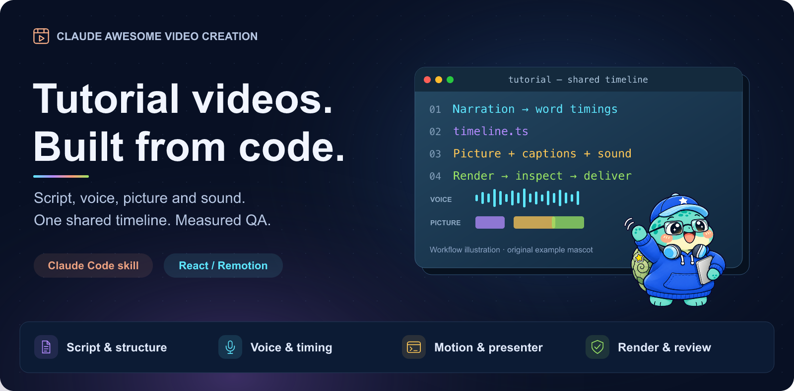
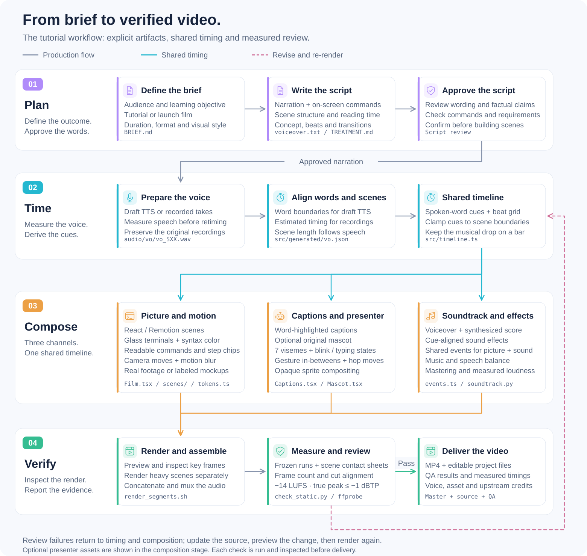
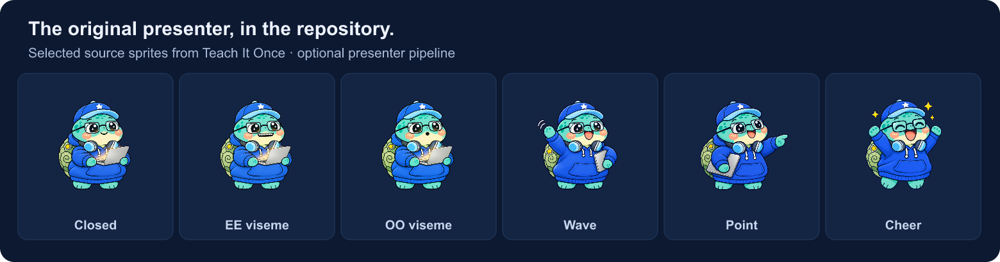

<p align="center">
  
</p>

<h1 align="center">Claude Awesome Video Creation</h1>

<p align="center">
  An Agent Skill for Claude Code that turns a brief into a follow-along tutorial or explainer video.<br>
  Script, voiceover, motion, captions, an optional mascot presenter, and measured quality checks.
</p>

<p align="center">
  <a href="https://github.com/HaochenSHI66/claude-awesome-video-creation/stargazers"></a>
  <a href="skills/claude-awesome-video-creation/SKILL.md"></a>
  <a href="skills/claude-awesome-video-creation/assets/remotion-starter/package.json"></a>
  <a href="LICENSE"></a>
</p>

<p align="center">
  <a href="#quick-start">Quick start</a> ·
  <a href="#production-workflow">Workflow</a> ·
  <a href="#how-the-parts-work-together">How it works</a> ·
  <a href="#worked-example-teach-it-once">Worked example</a> ·
  <a href="#quality-checks">Quality checks</a> ·
  <a href="#reference-guide">Reference guide</a>
</p>

The viewer should be able to pause the video, read the command, and try it on their own computer. This skill carries that requirement through the script, scene design, timing and final review. It builds on [cinetic](https://github.com/Leonxlnx/cinetic), adding a tutorial structure, voiceover timing, a sprite-based presenter and a render recipe developed while making *Teach It Once*.

## Quick start

Install the skill:

```bash
npx skills add HaochenSHI66/claude-awesome-video-creation
```

Then ask Claude Code in your project:

```text
Use the claude-awesome-video-creation skill to make a 2-minute tutorial
about [your feature] for [your audience]. Show the commands in full,
explain what each step does, and finish with a readable cheat sheet.
Use draft voiceover first. Let me review the script before building scenes.
```

You can also invoke `/claude-awesome-video-creation` directly. The agent starts by choosing the format, preparing the script and confirming the content before it builds the video. For a product showcase, ask for a launch film and specify the intended duration and destination.

<details>
<summary><strong>Requirements and optional tools</strong></summary>

The skill runs a local production toolchain. Install the dependencies for the parts of the workflow you use:

| Component | Requirement | Role |
| :--- | :--- | :--- |
| Coding agent | Claude Code | Reads the skill, prepares the project and runs the workflow |
| Video engine | Node.js 22+ and Remotion 4 | React scenes, previews and frame rendering; the starter declares its npm dependencies |
| Media tools | FFmpeg 6+ with ffprobe | Media assembly, loudness analysis, duration and frame checks |
| Audio and image scripts | Python 3.11+ with `numpy`, `scipy`, `soundfile`, `pyloudnorm`, `Pillow` | Sound synthesis, mastering, contact sheets and sprite processing |
| Draft voiceover, optional | `edge-tts` | Temporary narration with word boundaries |
| New mascot artwork, optional | Codex image generation | Original base art and consistent pose edits; the example includes its own sprites |

The Remotion render path uses headless Chromium. Follow the [engine guide](skills/claude-awesome-video-creation/references/remotion-engine.md) when setting up a new machine. Tutorial mode uses Remotion; the inherited craft guide also includes a [HyperFrames starter](skills/claude-awesome-video-creation/assets/hyperframes-starter/) for HTML/GSAP work.

</details>

## Production workflow

The workflow keeps concrete artifacts between stages: an approved script becomes voice takes; those takes produce timing data; the shared timeline coordinates the visual and audio channels. The final render is inspected and measured, and any failures lead back to the source before another cut is delivered.

<a href="docs/assets/workflow.svg"></a>

<p align="center"><sub>Open the diagram for full-size detail. <a href="docs/figures/specs/workflow.json">Editable layout specification</a> · <a href="docs/design-notes.md">Design rationale and sources</a></sub></p>

### Choose the format before writing the scenes

| Format | When to use it | Default approach |
| :--- | :--- | :--- |
| **Tutorial** | A viewer needs to install, configure or reproduce something | About 90–120 seconds; narration around 160 words per minute; complete commands, labeled steps and a cheat sheet viewers can pause to read |
| **Launch film** | A viewer needs to understand and remember a product or feature | About 20–45 seconds; a focused concept, a few proof moments, and the inherited cinetic motion and copy rules |

Tutorial mode allows the richer palette, glass terminals and step labels shown here. Launch films follow the tighter visual and copy rules in the [craft guide](skills/claude-awesome-video-creation/references/cinetic-core.md). Duration and pace are adjusted to the brief and measured speech.

## How the parts work together

<table>
  <tr>
    <td width="50%" valign="top"><br><strong>Script and teaching structure</strong><br>The hook establishes the result; the explanation leads into complete steps, a real run and a cheat sheet. Each scene answers the viewer’s next question.</td>
    <td width="50%" valign="top"><br><strong>Voice-driven timing</strong><br>Measured narration supplies the word cues. Scene lengths follow the speech, while the beat grid keeps animation and musical events aligned.</td>
  </tr>
  <tr>
    <td valign="top"><br><strong>Readable motion design</strong><br>A navy stage, Cobalt2-style terminals, syntax colors and consistent step chips make commands and explanations easy to locate as scenes move.</td>
    <td valign="top"><br><strong>An optional original presenter</strong><br>Word-driven mouth shapes, blink and typing states, gesture transitions and hop moves add character while keeping teaching content clear.</td>
  </tr>
  <tr>
    <td valign="top"><br><strong>Sound tied to the action</strong><br>Voiceover, a synthesized score and sound effects follow the same cue schedule as the picture. Mixing and mastering are checked on the rendered audio.</td>
    <td valign="top"><br><strong>Rendering with evidence</strong><br>Heavy scenes can use lower concurrency. Frame counts, frozen-run scans, contact sheets and loudness measurements support the final review.</td>
  </tr>
</table>

### Narration determines when things happen

In the [worked example’s timeline](skills/claude-awesome-video-creation/assets/examples/teach-it-once/timeline.ts), `vs('s05', 'loads')` looks up the spoken word, snaps its onset to the eighth-note grid and clamps the cue inside the scene. A missing word raises an error. Updating the voice take and rebuilding its timing data moves the dependent cues with it.

Draft TTS supplies word boundaries directly. For a real recording, the included workflow estimates word positions by syllable weight over the detected speech interval; it is an approximate alignment that should be reviewed. Scene lengths include breathing room around the measured speech, so a longer line leads to a timing change instead of an artificially compressed voice. See the [voiceover guide](skills/claude-awesome-video-creation/references/voiceover.md).

### Visual detail supports the explanation

The tutorial look uses a deep navy stage with slow aurora lighting, macOS-style window chrome and Cobalt2-blue terminal bodies. Commands, flags, paths and strings receive distinct syntax colors; cyan, violet and lime distinguish numbered steps. Palette and type tokens stay in one place so an iteration applies consistently across scenes.

Glass is simulated with translucent fills, a sheen, a rim and layered shadows. The [tutorial look guide](skills/claude-awesome-video-creation/references/look-tutorial.md) avoids real `backdrop-filter` in nested scenes because it caused renderer hangs in this workflow. Motion, legibility and layout are checked in rendered frames as well as in the preview.

### The presenter follows the same narration



The example ships **19 source sprites**, including seven mouth shapes (visemes), blinks, typing poses and gesture in-betweens. The presenter chooses mouth shapes from the letters of each spoken word, crossfades between them, and uses timed gesture and movement states. The [mascot guide](skills/claude-awesome-video-creation/references/mascot.md) explains the artwork and compositing pipeline.

New poses are edits of a locked original base, keyed from a consistent magenta background without cropping the canvas. Opaque blending prevents mouth swaps from making the character translucent. The presenter is placed around the teaching content and can leave the frame when a dense explanation needs the space.

## Worked example: Teach It Once

[*Teach It Once*](skills/claude-awesome-video-creation/assets/examples/teach-it-once/) is a tutorial about Claude Code Agent Skills, made with this skill. Its checked-in timeline defines a **116-second cut at 60 fps and 120 BPM**. The repository contains scene code, the narration script, timing logic, soundtrack scripts, captions and original presenter sprites for studying and adapting the implementation.

Start with the [voiceover script](skills/claude-awesome-video-creation/assets/examples/teach-it-once/voiceover.txt), then follow the [timeline](skills/claude-awesome-video-creation/assets/examples/teach-it-once/timeline.ts) into the [scene composition](skills/claude-awesome-video-creation/assets/examples/teach-it-once/Film.tsx). [Captions](skills/claude-awesome-video-creation/assets/examples/teach-it-once/Captions.tsx), [presenter animation](skills/claude-awesome-video-creation/assets/examples/teach-it-once/Mascot.tsx) and the [event schedule](skills/claude-awesome-video-creation/assets/examples/teach-it-once/events.ts) show how the channels stay coordinated.

The example is reference source. A render project also needs the shared starter libraries, its dependencies, generated timing JSON, fonts, audio and any recorded footage. Use the [Remotion starter](skills/claude-awesome-video-creation/assets/remotion-starter/) and [project scaffold script](skills/claude-awesome-video-creation/scripts/new-film.sh) when assembling a new film.

<details>
<summary><strong>The tutorial’s narrative structure</strong></summary>

| Viewer question | Scene sequence | What appears on screen |
| :--- | :--- | :--- |
| Why should I watch? | Hook → what it is → the problem | The result, the tool’s purpose and a problem the audience recognizes |
| How does it work? | Mechanism → STEP 1 / 2 / 3 | Real file paths with plain-language labels, complete commands, platform differences and account requirements |
| Does it actually work? | The real run → proof / reveal | Prompt entry, skill activation, a clearly marked speed-up and the result |
| How do I use it myself? | Make your own → share it → cheat sheet | A readable minimal file, how to share it, and every command and path collected for a pause |
| Where do I go next? | Beyond the basics → contact → call to action | Further uses, the author’s contact and an honest credit line |

This structure comes from a real feedback session with a student audience. [Lessons learned](skills/claude-awesome-video-creation/references/lessons.md) records the requests and the production rules they led to.

</details>

## Quality checks

The checks below are **delivery criteria**, not a claim that a new project has already passed. Run them on each cut, inspect the output, and report measurements with any intentional exceptions.

| Check | Evidence | Acceptance criterion |
| :--- | :--- | :--- |
| Duration and frame count | `ffprobe` | Output matches the composition’s expected duration and total frames |
| Unintended frozen runs | `scripts/check_static.py` | No unexplained frozen runs of 0.1 seconds or longer; intended holds are reviewed |
| Layout and readability | Scene contact sheets from `scripts/sheet.sh` | Commands and labels fit; captions and presenter do not cover teaching content |
| Cut and cue alignment | Frame checks around scene boundaries | Joins are clean and the drop lands on its intended cue |
| Audio mastering | FFmpeg loudness analysis | Tutorial target: −14 LUFS integrated; true peak at or below −1 dBTP |
| Presenter continuity | Frame tiles across gestures and moves | No visible pops, jitter or unintended transparency |

The [render and QA guide](skills/claude-awesome-video-creation/references/render-qa.md) covers segmented rendering and diagnosis when a heavy scene stops progressing. Lower concurrency is applied to the affected scene; the segments are concatenated and the soundtrack is muxed into the result. Any render-time figure shown in the video comes from a measured run of that cut.

Reconstructed terminals stay labeled until replaced by real footage. Draft synthetic narration and AI-generated artwork receive explicit credits. The film’s description reflects the actual production process, including multiple prompts and revisions.

## Reference guide

The [skill entry point](skills/claude-awesome-video-creation/SKILL.md) defines the modes and production gates. Read [lessons learned](skills/claude-awesome-video-creation/references/lessons.md) before making the first tutorial, then open the guide for the stage you are working on:

| Stage | Read next |
| :--- | :--- |
| Brief and story | [Concept and story](skills/claude-awesome-video-creation/references/concept-and-story.md) · [Treatment template](skills/claude-awesome-video-creation/assets/TREATMENT.md) · [Formats](skills/claude-awesome-video-creation/references/formats.md) |
| Voice and timing | [Voiceover](skills/claude-awesome-video-creation/references/voiceover.md) · [Timing grid](skills/claude-awesome-video-creation/references/timing-grid.md) |
| Visual design | [Tutorial look](skills/claude-awesome-video-creation/references/look-tutorial.md) · [Brand and color](skills/claude-awesome-video-creation/references/brand-and-color.md) · [Motion tokens](skills/claude-awesome-video-creation/references/motion-tokens.md) · [Transitions](skills/claude-awesome-video-creation/references/transitions.md) |
| Presenter | [Mascot pipeline](skills/claude-awesome-video-creation/references/mascot.md) · [Example animation](skills/claude-awesome-video-creation/assets/examples/teach-it-once/Mascot.tsx) |
| Sound | [Sound design](skills/claude-awesome-video-creation/references/sound.md) · [Audio tools](skills/claude-awesome-video-creation/scripts/audio/) |
| Engine and rendering | [Remotion](skills/claude-awesome-video-creation/references/remotion-engine.md) · [Chromium rendering](skills/claude-awesome-video-creation/references/chromium-rendering.md) · [Render and QA](skills/claude-awesome-video-creation/references/render-qa.md) |
| Review and delivery | [Review loop](skills/claude-awesome-video-creation/references/review-loop.md) · [Finishing](skills/claude-awesome-video-creation/references/finishing.md) |

<details>
<summary><strong>Repository layout</strong></summary>

```text
skills/claude-awesome-video-creation/
├── SKILL.md                     Modes, workflow and delivery criteria
├── references/                  Tutorial guides and inherited cinetic craft
├── scripts/                     Scaffolding, rendering, audio and QA tools
└── assets/
    ├── TREATMENT.md              Concept and beat-sheet template
    ├── remotion-starter/         React / Remotion project scaffold
    ├── hyperframes-starter/      HTML / GSAP alternative
    ├── critics/                 Review prompts
    ├── library/                 Motion technique library
    └── examples/teach-it-once/   Tutorial source and original mascot sprites
docs/
├── assets/                      README artwork and icons
├── figures/specs/workflow.json  Editable workflow content and geometry
├── render_assets.py             Rebuilds the SVG artwork
└── design-notes.md               Design references and maintenance notes
```

</details>

## Credits and license

Built on [cinetic](https://github.com/Leonxlnx/cinetic) by **Leonxlnx**, whose MIT-licensed craft guide, scripts and starters are included with attribution. This repository adds the tutorial mode, voiceover workflow, original presenter pipeline, segmented render and QA recipe, and lessons from the tutorial’s feedback sessions. The included cinetic material reflects this repository’s bundled version.

The README workflow design draws on the semantic-layout-first approach in [AutoFigure, ICLR 2026](https://openreview.net/forum?id=5N3z9JQJKq); [design notes](docs/design-notes.md) explain the references. The diagram is an original, editable SVG implementation.

**Author:** SHI Haochen · [24130819d@connect.polyu.hk](mailto:24130819d@connect.polyu.hk) · [MIT License](LICENSE)
